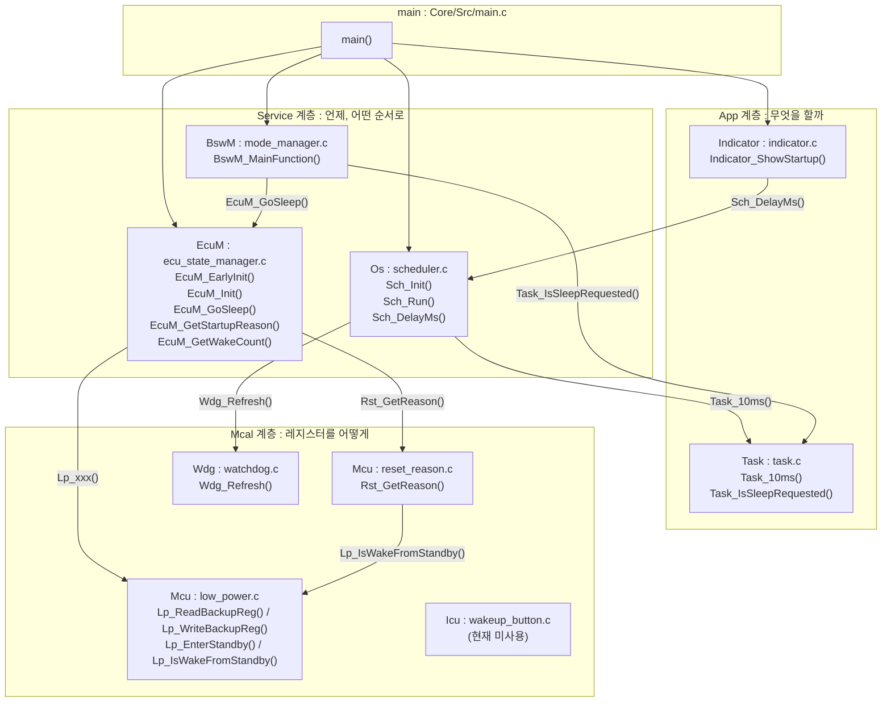
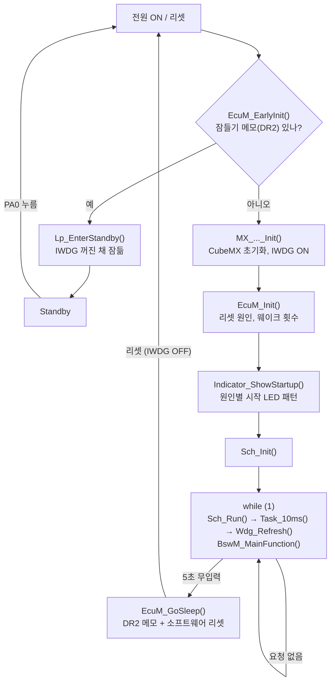

# Embedded_STM32 구조 문서

STM32F103C8 (Blue Pill)로 만든 작은 ECU 플랫폼 실습 프로젝트예요.
AUTOSAR의 계층 구조 (App, Service, Mcal)를 단순하게 따라 했어요.

> 구조가 바뀌는 커밋을 할 때는 이 문서도 함께 고쳐서 같은 커밋에 넣어요.
> 함수를 클릭해서 연결 관계를 보려면 [function_map.html](function_map.html)을 브라우저로 열어 보세요.

---

## 1. 파일 구조

```
Embedded_STM32/
├── Core/                         CubeMX가 생성 (USER CODE 영역만 수정)
│   ├── Src/main.c                초기화 순서 + while (1)
│   └── Startup/                  리셋 벡터, 벡터 테이블
├── Drivers/                      ST HAL 라이브러리 (수정하지 않음)
├── docs/                         구조 문서 (이 파일, function_map.html)
└── User/                         직접 작성한 코드
    ├── GDS/                      공통 정의
    │   ├── GDS.h                 #define, enum Rst_ReasonType
    │   └── GDS.c                 공통 상수/변수 자리
    ├── App/                      응용 계층: "무엇을 할까"
    │   ├── Task/                 task.c, task.h               10ms 할 일
    │   └── Indicator/            indicator.c, indicator.h     시작 LED 표시
    ├── Service/                  서비스 계층: "언제, 어떤 순서로"
    │   ├── EcuM/                 ecu_state_manager.c, .h      시작, 잠들기 절차
    │   ├── BswM/                 mode_manager.c, .h           잠들 조건 판단
    │   └── Os/                   scheduler.c, .h              10ms 스케줄러, 대기
    └── Mcal/                     하드웨어 계층: "레지스터를 어떻게"
        ├── Mcu/                  low_power.c, reset_reason.c (+ .h)   저전력, BKP, 리셋 원인
        ├── Wdg/                  watchdog.c, .h               IWDG Refresh
        └── Icu/                  wakeup_button.c, .h          EXTI 버튼 (현재 미사용)
```

---

## 2. 계층 구조와 연결

화살표는 "왼쪽이 오른쪽 함수를 부른다"는 뜻이에요.



### 계층 규칙

| 규칙 | 내용 |
|---|---|
| 위에서 아래로 호출 | main → App / Service → Mcal |
| App은 하드웨어 드라이버를 직접 부르지 않음 | 워치독 Refresh는 Os(`Sch_Run`, `Sch_DelayMs`)가 함 |
| Service가 App을 부르는 예외는 2가지만 | Os가 Task를 실행 (`Task_10ms`), BswM이 요청을 확인 (`Task_IsSleepRequested`) |
| EcuM은 표시하지 않음 | 리셋 원인과 웨이크 횟수만 저장, main이 꺼내서 Indicator에 넘김 |
| Mcal은 "어떻게"만 | BKP 칸의 의미 (DR1 웨이크 횟수, DR2 잠들기 메모)는 EcuM이 정함 |
| 값과 타입은 GDS에 | 모든 `#define`과 `enum`은 `User/GDS/GDS.h` |

---

## 3. 실행 흐름



### 왜 "잠들기 전 리셋"을 하나

| 문제 | 근거 |
|---|---|
| IWDG는 한번 켜면 끌 수 없다 | RM0008 5.3.4, p.75 |
| IWDG 클럭 (LSI)도 끌 수 없다 | RM0008 7.2.9, p.98 |
| 그대로 Standby에 들어가면 IWDG가 약 0.1초 만에 깨운다 | RM0008 19.2, p.494 |

그래서 리셋으로 IWDG를 끄고, 리셋 직후 `MX_IWDG_Init()`보다 먼저 `EcuM_EarlyInit()`에서 잠들어요.

---

## 4. 함수 역할

| 모듈 | 함수 | 역할 | 부르는 쪽 |
|---|---|---|---|
| Task | `Task_10ms()` | 500ms마다 LED 토글, PA0 5초 무입력 시 슬립 요청 | `Sch_Run()` |
| Task | `Task_IsSleepRequested()` | 슬립 요청 여부 (1 = 잠들 시간) | `BswM_MainFunction()` |
| Indicator | `Indicator_ShowStartup()` | 리셋 원인별 시작 LED 패턴 | `main()` |
| EcuM | `EcuM_EarlyInit()` | 메모가 있으면 IWDG 켜기 전에 Standby | `main()` (SysInit) |
| EcuM | `EcuM_Init()` | 리셋 원인 판단, 웨이크 횟수 처리 | `main()` |
| EcuM | `EcuM_GoSleep()` | DR2 메모 + 소프트웨어 리셋 | `BswM_MainFunction()` |
| EcuM | `EcuM_GetStartupReason()` | 이번 시작의 리셋 원인 | `main()` |
| EcuM | `EcuM_GetWakeCount()` | 현재 웨이크 횟수 | `main()` |
| BswM | `BswM_MainFunction()` | 슬립 조건 판단 → `EcuM_GoSleep()` | `main()` (while) |
| Os | `Sch_Init()` | TIM2 카운터 시작 | `main()` |
| Os | `Sch_Run()` | 10ms마다 `Task_10ms()`, 이후 `Wdg_Refresh()` | `main()` (while) |
| Os | `Sch_DelayMs()` | 스케줄러 시작 전 대기 (워치독 Refresh 포함) | `Indicator_ShowStartup()` |
| Mcu | `Lp_ReadBackupReg()` / `Lp_WriteBackupReg()` | BKP->DR1~DR10 읽기/쓰기 | EcuM |
| Mcu | `Lp_EnterStandby()` | PA0 웨이크업 허용 후 Standby | `EcuM_EarlyInit()` |
| Mcu | `Lp_IsWakeFromStandby()` | SBF 확인 후 지움 | `Rst_GetReason()` |
| Mcu | `Rst_GetReason()` | 리셋 원인 판별 (한 번만 호출) | `EcuM_Init()` |
| Wdg | `Wdg_Refresh()` | IWDG 카운터 다시 채움 | `Sch_Run()`, `Sch_DelayMs()` |
| Icu | `Wkup_CheckAndClear()` | 버튼 웨이크업 플래그 (현재 미사용) | 없음 |

`static` 함수 (`EcuM_IncWakeCount`, `EcuM_ClearWakeCount`, `EcuM_TakeSleepRequest`, `Indicator_Blink`, `Lp_EnableBackupAccess`)는 각 파일 맨 아래에 있어요.

---

## 5. 코드 규칙

- 파일 이름은 풀네임, 함수 접두어는 AUTOSAR 스타일 (`EcuM_`, `BswM_`, `Sch_`, `Lp_`, `Rst_`, `Wdg_`)
- `.c` 파일 순서: include → static 프로토타입 → 외부 공개 함수 → static 함수
- 모든 함수 위에 `[설명] [인자] [반환] [호출] [예시]` 주석
